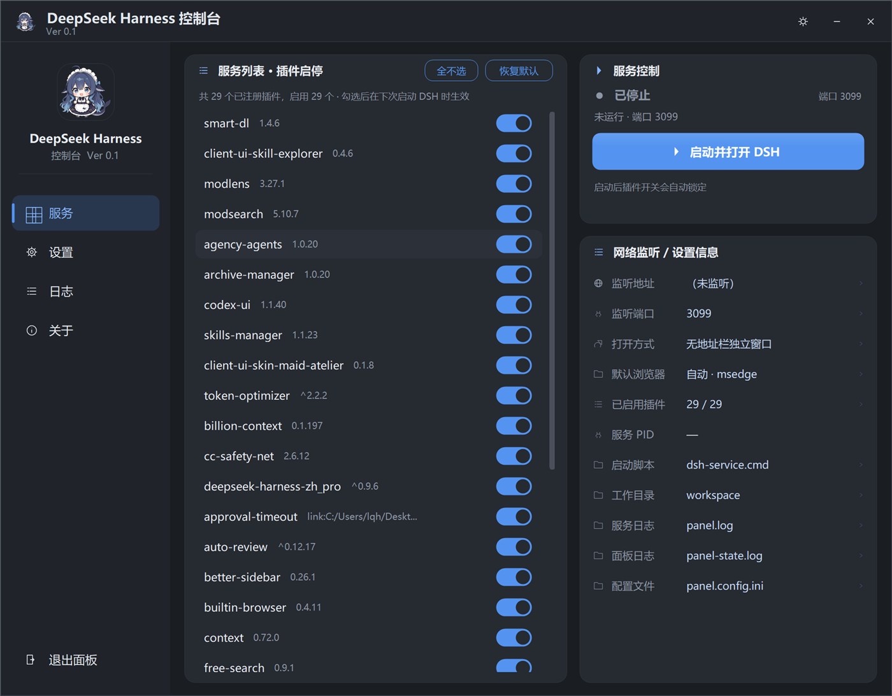

# DSH 控制面板（DeepSeek Harness 控制台）



给 [DeepSeek Harness](https://www.npmjs.com/package/@deepseek-ai/dsh) 配一个 Windows 托盘小面板：启停服务、开网页、勾插件、看日志，全部在这一块窗口里完成，不用再开黑框。

- 单文件绿色版：一个 `DshPanel.exe` + 一个图标，双击就能用，不需要安装、不需要运行时。
- 托盘常驻：点 × 收进托盘，右键菜单直接启动 / 重启 / 停止 / 退出。
- 高 DPI 正确：125% / 150% / 200% 缩放下字体和圆角都清晰，不糊不歪。
- 不碰你的 DSH 安装：只写你自己的配置目录，改插件前会先备份 `package.json`。

## 快速开始

1. 装好 DeepSeek Harness（`npm i -g @deepseek-ai/dsh`，或者按官方文档来）。装好后 `%USERPROFILE%\.dsh\profiles\web` 这个目录应该存在。
2. 下载 `DshPanel.exe` 和 `DeepSeekHarness-WhaleGirl.ico`，放在**同一个文件夹**里，双击 exe。
3. 第一次启动时面板会自动去这两个地方找 DSH 数据目录：
   - 环境变量 `DSH_HOME`
   - `%USERPROFILE%\.dsh`

   找到了就直接可用；没找到会弹窗提醒，同时自动跳到「设置 → DSH 目录」，点「选择…」指到你的 DSH 数据目录（里面应该有 `profiles` 文件夹）即可。
4. 点面板上的「启动并打开 DSH」，它会拉起服务并在浏览器里打开 `http://127.0.0.1:3080`。

## 界面

| 页面 | 能干什么 |
| --- | --- |
| 服务 | 启动 / 停止 / 重启 DSH、打开网页、勾选启用哪些插件（改完下次启动生效） |
| 设置 | DSH 目录、开机自启、启动后自动开网页、最小化到托盘、浏览器打开方式、关闭面板时是否停服、端口、启动纯净 DSH、开发者模式 |
| 日志 | 实时看服务日志和面板日志，可清空、可折叠 |
| 关于 | 版本、链接 |

## 从源码编译

需要 Windows 自带的 .NET Framework 4.x（`C:\WINDOWS\Microsoft.NET\Framework64\v4.0.30319\csc.exe`），没有其它依赖。

```bat
build-panel.cmd
```

产物在 `dist\DshPanel.exe`，图标会自动拷到旁边。

## 配置

面板把配置写在 `%LOCALAPPDATA%\DshPanel\panel.config.ini`（首次运行自动生成，带注释）。几个关键项：

| 键 | 说明 |
| --- | --- |
| `dshhome` | DSH 数据目录。留空 = 自动探测（先看环境变量 `DSH_HOME`，再看 `%USERPROFILE%\.dsh`） |
| `port` | 服务端口，默认 3080 |
| `workdir` | 启动 DSH 时的工作目录，默认当前用户主目录 |
| `pluginjson` | 插件清单路径。留空 = 跟着 `dshhome` 走 `profiles\web\package.json` |
| `svccmd` | 启动脚本写到哪。留空 = 面板数据目录下的 `dsh-run.cmd` |
| `autostart` / `autoopen` / `autotray` | 开机自启 / 启动后开网页 / 启动后最小化到托盘 |
| `stoponsvcclose` | 关闭面板时一并停止 DSH |

改完保存，重启面板生效。

## 常见问题

**提示「没有找到 DeepSeek Harness 的数据目录」**
面板只认安装时的默认位置，不做全盘扫描（扫全盘既慢又容易认错）。到「设置 → DSH 目录」点「选择…」，指到 `%USERPROFILE%\.dsh`。如果你把 DSH 装在别处，指到那个自定义的 `DSH_HOME` 也行。

**启动失败：90 秒内未检测到端口监听**
面板的日志会把服务日志的最后几行贴出来，照着看就行。最常见的是端口被别的程序占了 —— 换 `port` 再试。

**插件改完没生效**
插件开关写进 `package.json`，需要重启 DSH 才生效。服务运行时开关是锁住的，先停再改。

**某次更新后 DSH 起不来了，是不是插件搞坏了**
「设置 → 高级 → 启动纯净 DSH」会用官方默认插件集另起一个实例排查，不影响你原来的配置。

**开机自启（开机启动）在哪**
设置 → 常规 → 开机自启。它写的是当前用户的启动项，和面板随时可以关掉。

## 目录里都有什么

```
DshPanel.cs        主窗口、托盘、服务启停、配置读写
PanelUi.cs         界面布局、四个页面、设置项
PanelTheme.cs      自绘控件：圆角卡片、按钮、开关、滚动区、图标
PanelPlugins.cs    插件清单读写
PanelExtra.cs      小工具类
app.manifest       高 DPI 声明
build-panel.cmd    一键编译
```

## 许可

MIT
